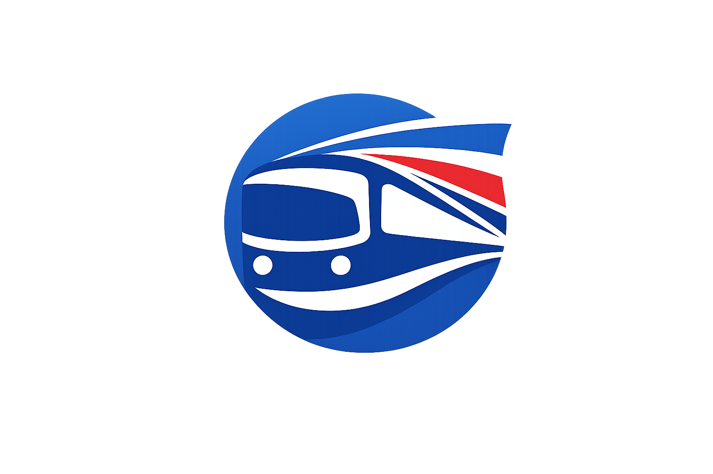

<p align="center">
  
</p>

<h1 align="center">BusALoTico 🚌 🇨🇷</h1>
<p align="center">
  <a href="https://es.wikipedia.org/wiki/Costa_Rica"></a>
  <a href="https://kotlinlang.org/"></a>
  <a href="https://github.com/JetBrains/compose-multiplatform/releases"></a>
</p>

<p align="center">  
Solución multiplataforma para el monitoreo inteligente de autobuses en Costa Rica.
</p>

## 📌 Descripción

**BusALoTico** es una iniciativa tecnológica diseñada para optimizar la experiencia de los usuarios de autobuses en Costa Rica mediante el uso de **Kotlin Multiplatform (KMP)**. La aplicación centraliza la información de las rutas, permitiendo a los pasajeros planificar sus viajes con datos precisos sobre paradas, horarios y la ubicación de las unidades en tiempo real.

Mediante una arquitectura moderna y robusta, BusALoTico ofrece una experiencia de usuario consistente en **Android**, **iOS** y **Escritorio**, eliminando la incertidumbre en las paradas y facilitando el uso diario del servicio de bus en el país.

## 📦 Estructura del Proyecto

El proyecto está organizado en módulos desacoplados que facilitan la reutilización de código y la separación de responsabilidades:

* **[app/shared](./app/shared)**: Módulo de interfaz de usuario compartida mediante **Compose Multiplatform**. Contiene las pantallas de la aplicación, componentes visuales, integración de mapas, temas y recursos comunes (imágenes, cadenas e íconos).
  - `commonMain`: Componentes de UI y navegación agnósticos a la plataforma.
  - `androidMain`: Recursos y renderizadores nativos de mapas para Android.
  - `iosMain`: Implementaciones nativas específicas de iOS.

* **[sharedLogic](./sharedLogic)**: Módulo central en Kotlin Multiplatform que alberga la arquitectura de datos y lógica de negocio.
  - `domain`: Define las reglas de negocio, entidades e interfaces de repositorios.
  - `data`: Implementa el almacenamiento **Local-First** utilizando **SQLDelight** y la sincronización remota mediante **Ktor** y **Firebase**.
  - `presentation`: Lógica de presentación y gestión de estado mediante **ViewModels** compartidos.
  - `di`: Configuración de inyección de dependencias con **Koin**.

* **[app/androidApp](./app/androidApp)**: Módulo de entrada nativo para **Android**. Punto de inicio de la aplicación (`MainActivity`), configuración de manifiesto y manejo de tokens para servicios de mapas.

* **[app/desktopApp](./app/desktopApp)**: Módulo de entrada para la versión de **Escritorio (JVM)**. Permite empaquetar la aplicación ejecutable para macOS, Windows y Linux.

* **[app/iosApp](./app/iosApp)**: Punto de entrada nativo para **iOS** en Swift, integrando la UI y lógica compartidas mediante el framework de Kotlin Multiplatform.

## Arquitectura


## 🛠️ Características Principales

- **🗺️ Geoposición de Rutas**: Integración con **Mapbox** para visualizar el recorrido exacto de las líneas de bus y la ubicación de las paradas.
- **🔍 Buscador de Líneas**: Sistema de filtrado por provincia, cantón y distrito para localizar rutas específicas de autobús.
- **🕒 Seguimiento de Unidades**: Monitoreo de buses mediante **Firebase Firestore**, permitiendo visualizar el avance de la unidad en el mapa.
- **🔖 Mis Rutas**: Acceso rápido a las líneas de autobús guardadas como favoritas por el usuario con almacenamiento persistente **Local-First** (SQLDelight).
- **📊 Datos de Operación**: Información sobre empresas autobuseras, frecuencias estimadas y alertas de servicio.
- **👤 Perfil de Usuario**: Gestión de preferencias personales y sincronización de datos entre plataformas.

## Diagramas de Secuencia

### Seguimiento de Ruta


### Detalle de Ruta


## ⚙️ Guía de Configuración

### Android
Para compilar y ejecutar en Android, asegúrese de tener configurado el `MAPBOX_ACCESS_TOKEN` en su archivo `local.properties`.
- **Línea de comandos (Windows):**
  ```shell
  .\gradlew.bat :app:androidApp:assembleDebug
  ```
- **Línea de comandos (macOS/Linux):**
  ```shell
  ./gradlew :app:androidApp:assembleDebug
  ```

### Escritorio
Para compilar y ejecutar la aplicación de escritorio:
- **Línea de comandos (Windows):**
  ```shell
  .\gradlew.bat :app:desktopApp:run
  ```
- **Línea de comandos (macOS/Linux):**
  ```shell
  ./gradlew :app:desktopApp:run
  ```

### iOS
La aplicación iOS requiere Xcode y un entorno macOS.
1. Navegue al directorio `app/iosApp`.
2. Abra `iosApp.xcodeproj` en Xcode.
3. Seleccione el dispositivo o simulador objetivo y presione **Run**.

## 🛠️ Stack Tecnológico

*   **[Kotlin Multiplatform](https://kotlinlang.org/docs/multiplatform.html)** - Compartición de lógica y UI.
*   **[Compose Multiplatform](https://www.jetbrains.com/lp/compose-multiplatform/)** - Interfaz de usuario declarativa compartida.
*   **[SQLDelight](https://cashapp.github.io/sqldelight/)** - Persistencia de datos local multiplataforma (Local-First).
*   **[Koin](https://insert-koin.io/)** - Inyección de dependencias.
*   **[Firebase](https://firebase.google.com/)** - Sincronización en la nube y datos de ubicación en tiempo real.
*   **[Mapbox SDK](https://www.mapbox.com/)** - Mapas y capacidades geoespaciales.
*   **[Ktor Client](https://ktor.io/)** - Cliente HTTP para servicios REST.
*   **[Kotlinx Serialization](https://github.com/Kotlin/kotlinx.serialization)** - Serialización JSON.
*   **[Coroutines & Flow](https://kotlinlang.org/docs/coroutines-overview.html)** - Programación asíncrona y reactiva.

---

Este proyecto está enfocado en mejorar la movilidad y el acceso a la información del sistema de buses en Costa Rica.
