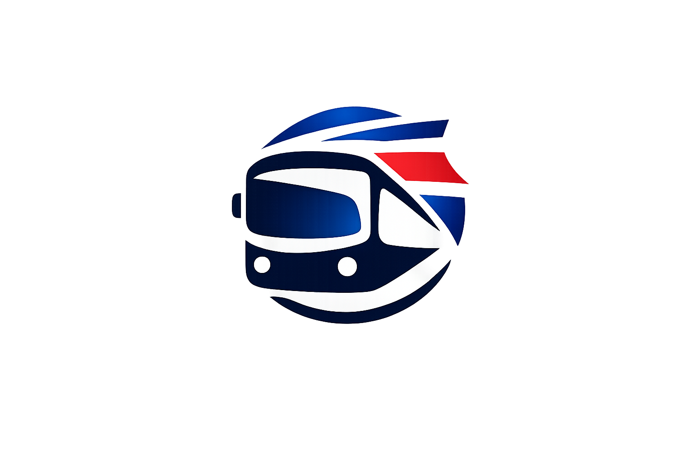
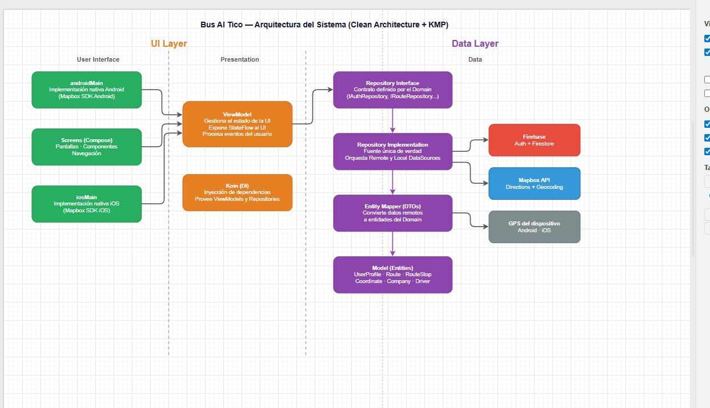
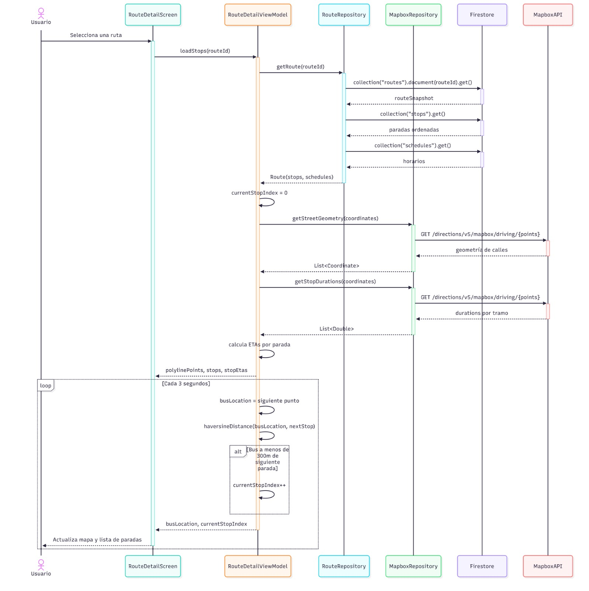
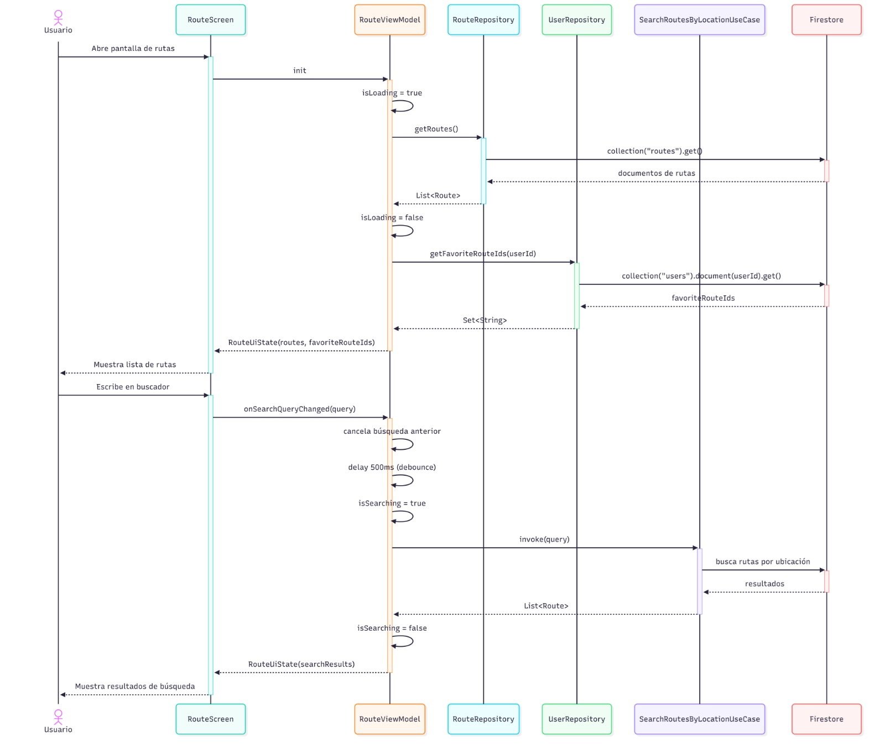

<p align="center">
  
</p>

<h1 align="center">BusALoTico 🚌 🇨🇷</h1>
<p align="center">
  <a href="https://es.wikipedia.org/wiki/Costa_Rica"></a>
  <a href="https://kotlinlang.org/"></a>
  <a href="https://github.com/JetBrains/compose-multiplatform/releases"></a>
</p>

<p align="center">  
Solución multiplataforma para el monitoreo inteligente de autobuses en Costa Rica.
</p>

## 📌 Descripción

**BusALoTico** es una iniciativa tecnológica diseñada para optimizar la experiencia de los usuarios de autobuses en Costa Rica mediante el uso de **Kotlin Multiplatform (KMP)**. La aplicación centraliza la información de las rutas, permitiendo a los pasajeros planificar sus viajes con datos precisos sobre paradas, horarios y la ubicación de las unidades en tiempo real.

Mediante una arquitectura moderna y robusta, BusALoTico ofrece una experiencia de usuario consistente tanto en **Android** como en **iOS**, eliminando la incertidumbre en las paradas y facilitando el uso diario del servicio de bus en el país.

## 📦 Estructura del Proyecto

El proyecto está organizado en módulos que facilitan la reutilización de código y la separación de responsabilidades:

* **[/composeApp](./composeApp/src)**: Contiene la implementación de la interfaz de usuario compartida. Utiliza Compose Multiplatform para renderizar pantallas en múltiples sistemas operativos desde una única base de código.
  - `commonMain`: Código de UI agnóstico a la plataforma.
  - `androidMain`: Recursos e implementaciones específicas de Android.

* **[/shared](./shared/src)**: Módulo núcleo donde reside la lógica de negocio, el manejo de datos y las integraciones externas.
  - `domain`: Define las reglas de negocio, entidades y contratos (interfaces).
  - `data`: Implementa la persistencia de datos y el consumo de servicios (Ktor, Firebase).
  - `presentation`: Maneja el estado de la aplicación mediante ViewModels compartidos.

* **[/iosApp](./iosApp/iosApp)**: Punto de entrada para la plataforma iOS, actuando como el contenedor nativo necesario para desplegar la aplicación en dispositivos Apple.

## Arquitectura



## 🛠️ Características Principales

- **🗺️ Geoposición de Rutas**: Integración con **Mapbox** para visualizar el recorrido exacto de las líneas de bus y la ubicación de las paradas.
- **🔍 Buscador de Líneas**: Sistema de filtrado por provincia, cantón y distrito para localizar rutas específicas de autobús.
- **🕒 Seguimiento de Unidades**: Monitoreo de buses mediante **Firebase Firestore**, permitiendo visualizar el avance de la unidad en el mapa.
- **🔖 Mis Rutas**: Acceso rápido a las líneas de autobús guardadas como favoritas por el usuario.
- **📊 Datos de Operación**: Información sobre empresas autobuseras, frecuencias estimadas y alertas de servicio.
- **👤 Perfil de Usuario**: Gestión de preferencias personales y sincronización de datos entre plataformas.

## Diagrama de Secuencia Seguimiento de Ruta


## Diagrama de Secuencia Detalle de Ruta


## Diagrama de Secuencia Auth


## ⚙️ Guía de Configuración

### Android
Para compilar y ejecutar en Android, asegúrese de tener configurado el `MAPBOX_ACCESS_TOKEN` en sus propiedades locales.
- **Línea de comandos (Windows):**
  ```shell
  .\gradlew.bat :composeApp:assembleDebug
  ```
- **Línea de comandos (macOS/Linux):**
  ```shell
  ./gradlew :composeApp:assembleDebug
  ```

### iOS
La aplicación iOS requiere Xcode y un entorno macOS.
1. Navegue al directorio `iosApp`.
2. Ejecute `pod install` si es necesario.
3. Abra el proyecto en Xcode y presione **Run**.

## 🛠️ Stack Tecnológico

*   **[Kotlin Multiplatform](https://kotlinlang.org/docs/multiplatform.html)** - Compartición de lógica.
*   **[Compose Multiplatform](https://www.jetbrains.com/lp/compose-multiplatform/)** - UI compartida moderna.
*   **[Koin](https://insert-koin.io/)** - Inyección de dependencias multiplataforma.
*   **[Firebase](https://firebase.google.com/)** - Infraestructura en la nube para datos de ubicación en tiempo real.
*   **[Mapbox SDK](https://www.mapbox.com/)** - Visualización de mapas y capas geoespaciales.
*   **[Ktor Client](https://ktor.io/)** - Comunicación con APIs de servicios.
*   **[Kotlinx Serialization](https://github.com/Kotlin/kotlinx.serialization)** - Serialización eficiente de datos.
*   **[Coroutines & Flow](https://kotlinlang.org/docs/coroutines-overview.html)** - Manejo reactivo de la ubicación y el estado.

---

Este proyecto está enfocado en mejorar la movilidad y el acceso a la información del sistema de buses en Costa Rica.

